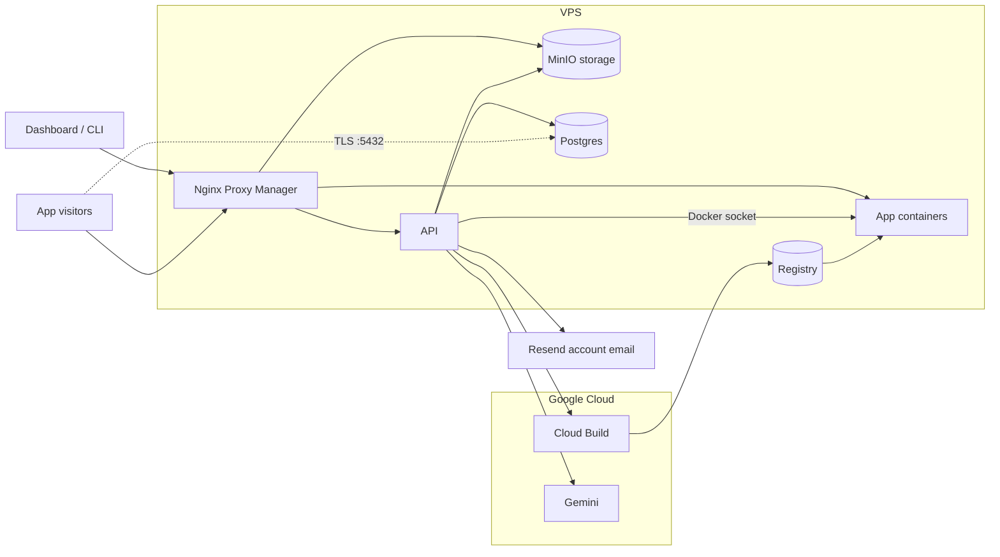

# Reverhost Architecture

Reverhost hosts Node.js apps, AI-built apps, Postgres databases and S3 storage. Everything runs on one VPS behind Nginx Proxy Manager. Image builds run on Google Cloud Build so the VPS only pulls and runs images.

## Components

- **server**: Hono API on Node with Prisma and Zod. Runs the build queue and AI jobs in the same process. In production it also serves the marketing site and the dashboard, both baked into its image.
- **client**: React 19 dashboard (Vite, React Query, shadcn/ui), calling the API through a typed Hono client.
- **cli**: `ezhst`, with the same features as the dashboard. Supports `--json` and token auth so AI agents can drive it.
- **marketing**: Astro static site with docs and generated SEO pages.
- **ai-runtime**: Docker image that AI-built apps run on.

## Routing

Nginx Proxy Manager terminates TLS with a wildcard certificate and does all HTTP routing:

- `reverhost.com`, `app.`, `api.` go to the API, which serves marketing, the dashboard or the API by Host.
- `storage.` goes to MinIO, `registry.` to the Docker registry.
- `<slug>.easyhost.fun` goes to the container `eh-app-<slug>`, resolved by Docker DNS at request time, so a new app needs no routing setup.
- Custom domains get their own certificate and proxy host, created through the NPM API after DNS is verified.

## Deploys

1. `ezhst deploy` uploads the source as a tarball, stored in MinIO.
2. The API queues the build in Postgres. Workers claim jobs with `FOR UPDATE SKIP LOCKED`, run a few at once, and never two for the same app.
3. The API generates a Dockerfile from the detected package manager, build and start commands (overridable per app) and uploads the context to Cloud Storage.
4. Cloud Build builds the image and pushes it to the self-hosted registry. The API streams the build log into the deployment.
5. The API pulls the image and replaces the app container. Old images are deleted.

App env is passed to builds as a BuildKit secret, never as build args. Builds in progress resume after an API restart.

## AI apps

The user chats with a Gemini agent in the dashboard. The agent reads and edits files stored in MinIO, and changes are pushed into a running container that hot reloads, so the preview updates live. For bigger requests it first asks questions, proposes a plan and lets the user pick a theme. Database and storage are created only when the agent first needs them. Each user gets one free app and build, then usage is charged from a token balance bought through Lemon Squeezy.

## Data

- **Postgres**: one instance holds the platform database and every customer database. Each customer database has its own role, customers cannot reach platform databases, and connections require TLS.
- **MinIO**: S3 compatible. Each bucket has its own access key scoped to that bucket. Files are public by URL.
- **Email**: account emails (verification codes, password resets, invites) are sent through Resend.

## Configuration

One root `.env` for every environment, validated at startup with no fallbacks. Limits (projects, apps, builds) live in `server/src/lib/limits.ts`.
